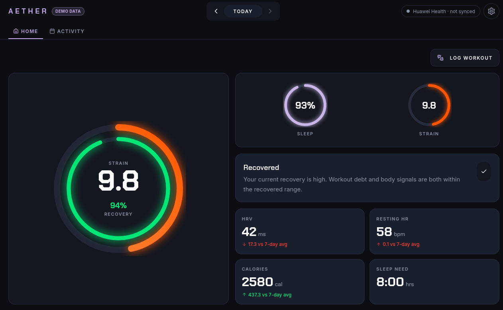
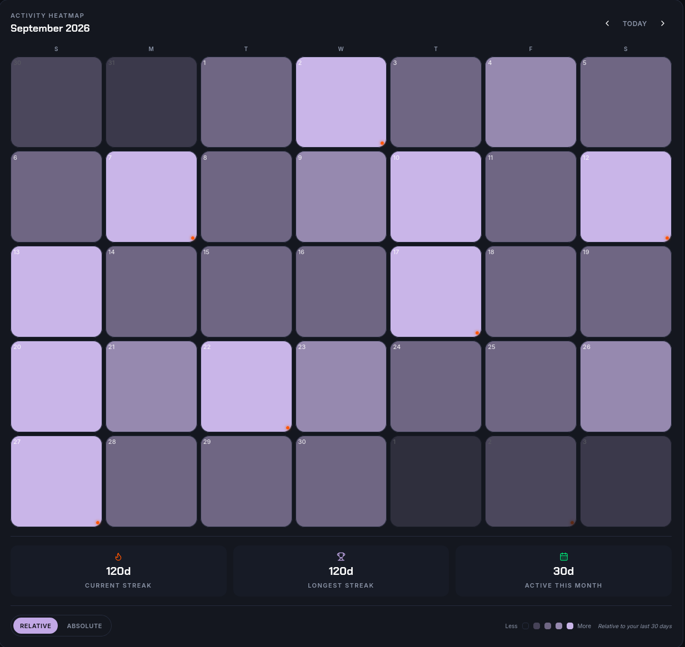
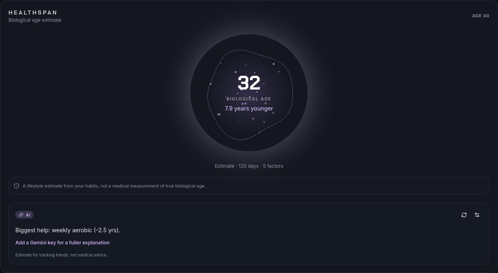

<h1 align="center">

**🦋 Aether Health**



</h1>

<h2 align ="center">

_Your Watch Data. Finally Readable._


</h2>

<div align="center">

Aether Health is a _privacy-first_ dashboard that turns your **Huawei watch data** into **recovery, sleep and strain scores** you can actually understand. Import a **Gadgetbridge** export and it builds everything from **your own baselines** instead of population averages, and your records are locked to **your own account**.

</div>

# 📸 Screenshots

<div align="center">

| Activity | Biological Age |
| :---: | :---: |
|  |  |

<sub>Screenshots use demo data (demo mode can be turned on in settings).</sub>

</div>

# 📘 What's Inside

### 🦋 Butterfly Recovery System (BRS v1.2)
**100% means fully recovered.** A hard workout drops it, and it climbs back using your watch's own recovery time, adjusted by your **HRV, resting heart rate and sleep**. It also shows roughly how many hours are left until you're back at full. It's an _estimate_, not a measurement.

### 😴 Sleep & Strain
A sleep score against a need that grows on hard days, a real **bed and wake time consistency** score, and strain built from **heart rate zones** instead of just steps.

### 🗓️ Adaptive Heatmap
Your activity calendar scales to **your last 30 days**. If you train hard all the time, a mild walk won't light up like a real session.

### 🧬 Biological Age
Your habits add or remove years compared to your actual age. Needs about a month of data to unlock. There's an optional AI explanation using **your own Gemini key**, stored only in your browser.

# 📘 Setup

Want to run your own copy? Aether Health is a web app, so you'll need **Node.js** and a free **Firebase** project (Auth + Firestore, the free Spark plan is enough).

### 1. Clone & Install
```
git clone https://github.com/HyperionOS-dev/Aether-Health
cd Aether-Health
npm install
```

### 2. Add Your Firebase Config
```
cp .env.example .env.local
```
Fill in your Firebase web config, point the CLI at **your** project with `firebase use --add`, then deploy the included `firestore.rules` (`firebase deploy --only firestore:rules`). They lock every account to its own data.

### 3. Run It
```
npm run dev
```

### 4. Host It
```
npm run build
```
This creates a static `dist/` folder you can host anywhere, like Cloudflare Pages. Add your site's domain to **Firebase Authentication → Settings → Authorized domains**, or sign-in won't work there.

### 📥 Importing Your Data
Export your data from **Gadgetbridge**, then upload it in the Sync panel — either the zip of table files, the database file itself (both are read in your browser), an individual table CSV, or a FIT activity file (such as a walk or run recorded on the watch), which adds its workouts. Want to look around first? Turn on demo mode in settings and it loads fake data that never gets saved.

# 🛠️ Built With

React · JavaScript · TypeScript · Firebase (Auth + Firestore)

# 🔒 Privacy

- Imports are parsed **in your browser**. Your export file is never uploaded, only the resulting records are saved. A Gadgetbridge database is read with SQLite compiled to WebAssembly (sql.js), which runs locally in your browser; parsing it sends nothing anywhere.
- Records are stored in **Firestore under your account**, and the security rules stop other accounts from reading or writing them.
- Your Gemini key stays in your browser's `localStorage`. Only your age and score numbers get sent to Gemini, never dates or raw heart rate.
- Free Gemini keys can be used by Google to improve its products, so skip the AI bubble if that bugs you.
- No ads, no analytics.

> [!WARNING]
> Aether Health gives **estimates**, not medical advice. Don't use it to diagnose anything or to make health decisions. That's a doctor's job.

# 🔔 Credits
- Code written by **HyperionOS Project**.
- Repo Designed by **Glazzite**.
- Inspired by **WHOOP** and **Huawei Health**, built on data from **Gadgetbridge**. Not affiliated with any of them.

> [!NOTE]
> Built with a bit of help from AI and tested on real watch data. It handles health data, so review the code before you trust it with yours.

> [!IMPORTANT]
> Copyright (C) 2026 HyperionOS Project. Licensed under **GNU Affero General Public License v3.0**. If you host a modified version, you have to share your source too.

<h2 align="center">
🙏 Thanks For Checking It Out!

Stay Recovered 💜
</h2>

<h4 align="center">
Rest Easy. 🦋
</h4>
